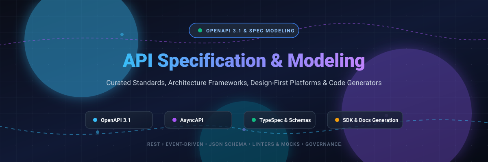

  

# 🚀 Awesome API Specification, Modeling & OpenAPI Tools

  
  
  
  

> 📚 A curated list of awesome tools, platforms, specifications, and libraries for API specification, data modeling, contract design, OpenAPI (OAS 3.0/3.1), AsyncAPI, and documentation generation.

API specification and modeling frameworks enable design-first and schema-driven engineering workflows. They ensure seamless cross-functional collaboration, contract testing, mock simulation, and automated client/server code generation across distributed microservice architectures. 🛠️✨

---

## 📑 Contents

- [📊 Sector Overview & Market Dynamics](#-sector-overview--market-dynamics)
- [☁️ SaaS Products & Platforms](#️-saas-products--platforms)
- [💻 Open-Source Tools & Frameworks](#-open-source-tools--frameworks)
- [📜 Specifications & Standards](#-specifications--standards)
- [🌟 Star History](#-star-history)
- [💖 Support & Sponsorship](#-support--sponsorship)
- [🤝 Contributing](#-contributing)

---

## 📊 Sector Overview & Market Dynamics

The global API management and design-tooling market is estimated at **$6.9B–$8.2B in 2025** and projected to exceed **$10B+ by 2026** (CAGR ~25–28%). 📈

The sector is **moderately fragmented**: enterprise runtime gateways and full-lifecycle suites exhibit high vendor consolidation around hyperscalers and key leaders, whereas the API design, contract modeling, and developer tooling layers remain dynamic and fragmented with vibrant competition between venture-backed SaaS platforms and community-driven open-source ecosystems. 🌐

---

## ☁️ SaaS Products & Platforms

Curated list of commercial SaaS platforms for API design, schema modeling, governance, and collaborative developer portals. Sorted descending by company size (valuation / estimated market standing). 🏢💼

| Product | Company Size (Valuation / Revenue) | Pricing | Free Tier / Trial Limits | Description |
|---|---|---|---|---|
| [**Postman**](https://www.postman.com/) | **$5.6B Valuation** (~$3.5B–$4.0B secondary; 30M+ users) | **$9/month** (Solo, annual) or **$19/user/month** (Team, annual) | **Free forever plan limited to 1 user** (solo workspace, native Git integration, unlimited mock servers/specs, and 50 AI credits/mo). | Collaborative API lifecycle platform supporting OpenAPI spec design, automated testing, mock servers, and workspace governance. |
| [**SmartBear SwaggerHub**](https://smartbear.com/swaggerhub/) | **~$2.0B–$3.0B Valuation** (~$150M–$500M ARR across SmartBear suite) | **$19/user/month** (Individual, annual) or **$29/user/month** (Team, annual) | **Free forever plan limited to 1–2 private APIs** (includes unlimited public APIs, basic OpenAPI 2.0/3.0/3.1 editor, and community docs). | Enterprise-ready visual OpenAPI design and documentation platform with centralized component domains and automated CI/CD synchronization. |
| [**Stoplight**](https://stoplight.io/) | **~$5M–$50M Acquisition** (Acquired by SmartBear; $6M prior funding) | **$44/month** (Basic, 3 users, annual) or **$113/month** (Startup, 8 users, annual) | **Free forever plan limited to 1 user and 1 project** (visual API/JSON Schema editor, interactive docs, and mock servers). | Design-first API design and governance solution with visual modeling, style guides (Spectral), and interactive docs. |
| [**Redocly**](https://redocly.com/) | **Early Venture / Bootstrapped** (Profitable B2B developer portal vendor) | **$249/month** (Pro, billed annually at $2,988/yr, covers 3 projects) | **30-day free trial** with full Pro/Scale feature access (no permanent cloud free tier; open-source CLI/Redoc engine remains free forever). | Developer portal and API documentation platform offering Git-based workflows, linting, interactive mock servers, and unlimited seats on paid tiers. |
| [**Fern**](https://buildwithfern.com/) | **$13M Total Raised** (Acquired by Postman in 2026; ~$3.3M ARR) | **Free tier available**; Enterprise plans with custom quote for multi-language SDKs | **Free forever plan limited to 10 team seats** (includes 1 doc site on custom domain, API explorer, and 250 AI credits/month). | Turnkey OpenAPI-first documentation platform and code generator that builds production-grade SDKs (TypeScript, Python, Go, Java) from API specs. |
| [**Apidog**](https://apidog.com/) | **Bootstrapped** (Self-funded, rapid growth alternative to Postman) | **$9/user/month** (Basic) or **$18/user/month** (Professional) | **Free forever plan limited to 4 team members** (unlimited API specifications, unlimited mock server calls, and unlimited test runs). | All-in-one API development platform combining visual API design, specification synchronization, debugging, automated testing, and mock servers. |

---

## 💻 Open-Source Tools & Frameworks

Open-source tools, linting engines, and editors for OpenAPI, AsyncAPI, and schema specifications. Sorted descending by GitHub Stars_Count. 🔓⭐

| Tool | GitHub_Stars | License | Description |
|---|---|---|---|
| [**OpenAPI Specification**](https://github.com/OAI/OpenAPI-Specification) |  | Apache-2.0 | The official OpenAPI Specification (OAS) standard repository defining vendor-neutral REST API description interfaces. |
| [**Swagger UI**](https://github.com/swagger-api/swagger-ui) |  | Apache-2.0 | Interactive, browser-based user interface that dynamically generates documentation and sandbox execution environments from OpenAPI specifications. |
| [**OpenAPI Generator**](https://github.com/OpenAPITools/openapi-generator) |  | Apache-2.0 | Multi-language code generator that produces API client SDKs, server stubs, documentation, and configuration files from OpenAPI 2.0/3.x specs across 50+ languages. |
| [**Redoc**](https://github.com/Redocly/redoc) |  | MIT | Ultra-fast, clean, and responsive open-source documentation generator for OpenAPI 2.0 and 3.x specifications with 3-panel responsive layout. |
| [**Scalar**](https://github.com/scalar/scalar) |  | MIT | Modern, high-performance API reference documentation and interactive client generator supporting OpenAPI 3.0 and 3.1. |
| [**Swagger Editor**](https://github.com/swagger-api/swagger-editor) |  | Apache-2.0 | Browser-based visual and text editor to design, describe, and document APIs using OpenAPI specifications with live linting and rendering. |
| [**TypeSpec**](https://github.com/microsoft/typespec) |  | MIT | Microsoft's modern concise language for describing cloud APIs and schemas that emits standard OpenAPI 3.0, JSON Schema, and client SDKs. |
| [**Prism**](https://github.com/stoplightio/prism) |  | Apache-2.0 | Turnkey open-source HTTP mock server that simulates realistic API traffic and contract-checks incoming requests directly against OpenAPI specifications. |
| [**Spectral**](https://github.com/stoplightio/spectral) |  | Apache-2.0 | Flexible JSON/YAML linter and API style guide engine for OpenAPI, AsyncAPI, and custom schema validation across CI/CD pipelines. |
| [**Stoplight Elements**](https://github.com/stoplightio/elements) |  | Apache-2.0 | Embeddable, customizable React and Web Components for beautiful, interactive OpenAPI and Markdown API documentation. |
| [**Apicurio Registry**](https://github.com/Apicurio/apicurio-registry) |  | Apache-2.0 | Open-source central schema and API contract registry supporting OpenAPI, AsyncAPI, Apache Avro, Protobuf, and JSON Schema with built-in Drafts editing. |

---

## 📜 Specifications & Standards

- 📘 **[OpenAPI Specification (OAS)](https://spec.openapis.org/oas/latest.html)**: Industry standard specification for machine-readable REST API contracts.
- ⚡ **[AsyncAPI Specification](https://www.asyncapi.com/docs/specifications/latest)**: Open standard for event-driven architectures, WebSockets, Kafka, and message queues.
- 📐 **[JSON Schema](https://json-schema.org/)**: Declarative language for annotating and validating structured JSON documents.
- 🔗 **[GraphQL](https://spec.graphql.org/)**: Query language and server-side runtime for executing queries using a type system.

---

## 🌟 Star History

---

## 💖 Support & Sponsorship

Thank you so much for exploring this curated repository! If this resource helps your API development journey, streamlines your contract workflows, or helps your engineering team adopt OpenAPI standards, please consider supporting the project:

- ⭐ **Star this repository** to help others discover it.
- 🍴 **Fork the project** and share it with your developer community.
- ☕ **Buy me a coffee**: Support ongoing maintenance and new curated additions on the [GitHub Sponsors Dashboard](https://github.com/sponsors/ishandutta2007).

Your encouragement and support are greatly appreciated! 🙌

---

## 🤝 Contributing

Contributions are warmly welcome! Please check out our contribution guidelines:
1. Ensure the tool or platform directly supports API specification, modeling, linting, or documentation.
2. For SaaS tools, provide verified starting pricing and exact free tier limits.
3. For open-source tools, link to active repositories with standard licenses.
4. Open a pull request with clear details!
